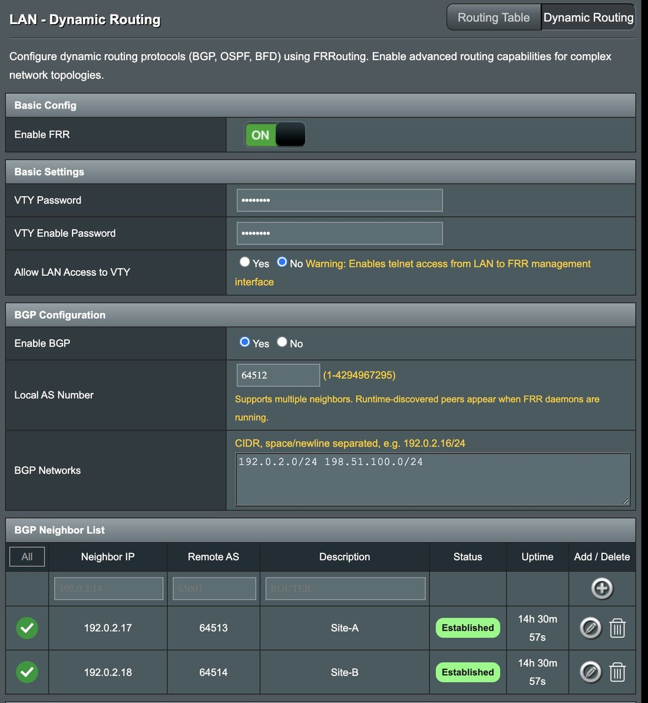
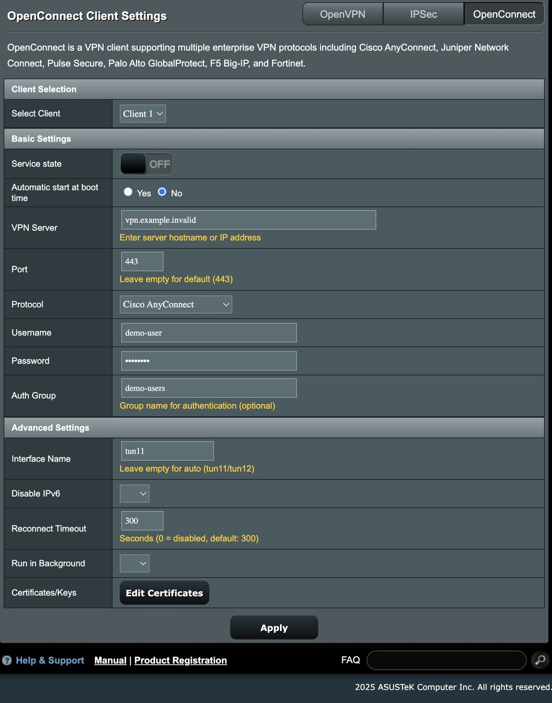

<p align="center">
  
</p>

# Asuswrt-Merlin for DSL-AC68U

Community-maintained 386.x firmware for the **ASUS DSL-AC68U**, with integrated
routing and VPN tools, WebUI improvements, and selected security and reliability fixes.

**[Download Firmware](https://github.com/oivano/asuswrt-merlin.ng/releases/latest)**
&middot; [What's Changed](Changelog-386.txt)
&middot; [Support](https://www.snbforums.com/forums/asuswrt-merlin.42/)
&middot; [Build From Source](#build-from-source)

[](https://github.com/oivano/asuswrt-merlin.ng/releases/latest)
[](https://github.com/oivano/asuswrt-merlin.ng/releases)
[](https://circleci.com/gh/oivano/asuswrt-merlin.ng/tree/DEV-nextrelease)

> **You're viewing `DEV`, the integration branch.** For router installation, use a
> published release and read its release notes. Development changes may not yet be
> included in published firmware.

## Why This Fork

Focused on one model, this fork builds on Asuswrt-Merlin with practical additions
for DSL-AC68U owners who want more control over routing, VPNs, and administration.

| Area           | Repository highlights                                                                                                 |
| -------------- | --------------------------------------------------------------------------------------------------------------------- |
| Routing        | FRR integration with WebUI configuration and route status.                                                            |
| VPN            | OpenVPN and an integrated dual-client OpenConnect interface.                                                          |
| IPsec Client   | Reworked StrongSwan client with configurable AES-256, SHA-2, and elliptic-curve DH/PFS options, including Curve25519. |
| DNS            | Native DNSCrypt integration and dnsmasq-based DNS blocklist support.                                                  |
| Administration | IPv4 inbound firewall rule management, improved connection views, and optional SFTP, disabled by default.             |
| Maintenance    | Selected security backports, package updates, and fixes for service startup, restart, and WebUI reliability.          |
| Lean Build     | AiMesh (AMAS) and Broadcom deep packet inspection (BWDPI) features are stripped from the enabled feature set.         |

AiMesh mesh orchestration and BWDPI-based traffic inspection are deliberately left
out to keep the focus on core routing and reduce background-service complexity
and resource overhead on this legacy hardware. AiMesh and BWDPI-dependent features
are unavailable; compatibility code and stubs remain where vendor binaries require them.

Other excluded extras include AiCloud/AiDisk cloud access, WebDAV sharing, media-server
and Time Machine integration, printer sharing, repeater mode, and the built-in Ookla
speed test.

See the
[changelog](Changelog-386.txt) and your chosen release's notes for availability and versions.

## WebUI Preview

<table>
  <tr><th>FRR Dynamic Routing</th><th>OpenConnect VPN Client</th></tr>
  <tr>
    <td><a href="docs/images/frr-routing.jpg"></a></td>
    <td><a href="docs/images/openconnect-client.jpg"></a></td>
  </tr>
</table>

Captured from a DSL-AC68U running a `DEV` build.

## Download & Compatibility

**Supported hardware: ASUS DSL-AC68U only.** This firmware is not for the RT-AC68U
or other similarly named ASUS models.

1. Open the [latest published release](https://github.com/oivano/asuswrt-merlin.ng/releases/latest).
2. Read its notes and confirm that the image is intended for your model and
   installation. Back up your settings before upgrading.
3. Check the image against its accompanying checksum, when provided. Keep recovery
   instructions available before flashing.

**DSL image variants matter.** The release pipeline distinguishes DSL-bundled
images from base images labeled `NO-DSL-FIRMWARE`. That label identifies an image
without bundled DSL firmware; it is not, by itself, installation guidance. Follow
release-specific instructions. If the correct variant for your setup is unclear,
ask in the support forum before flashing.

**Know the platform's limits.** This is a legacy 386.x platform using Linux 2.6.36
and proprietary vendor components. Selected fixes and newer userland packages do
not make the entire platform current or eliminate security risks. Do not assume
that features available on newer Asuswrt-Merlin platforms are available here.
This is a community fork, not an official ASUS or upstream Asuswrt-Merlin release.

## Development Status

| Branch                                                                                  | Purpose                                          |
| --------------------------------------------------------------------------------------- | ------------------------------------------------ |
| [`DEV`](https://github.com/oivano/asuswrt-merlin.ng/tree/DEV)                           | Upstream integration and ongoing development.    |
| [`DEV-nextrelease`](https://github.com/oivano/asuswrt-merlin.ng/tree/DEV-nextrelease)   | Release-candidate branch, kept releasable.       |
| [`DEV-experimental`](https://github.com/oivano/asuswrt-merlin.ng/tree/DEV-experimental) | Experimental work not yet ready for integration. |

## Build From Source

Use Linux with Docker installed and running, permission to use Docker, and network
access to pull the toolchain image. Run builds through [tools/build.sh](tools/build.sh),

```bash
git clone --branch DEV https://github.com/oivano/asuswrt-merlin.ng.git
cd asuswrt-merlin.ng
./tools/build.sh
```

The build runs in a detached container. Interrupting the log viewer does not stop
it; run `./tools/build.sh` again to reattach. Logs are written to
`tools/build/build.log`; completed images and SHA-256 checksum files are copied
to `tools/build/`. Use `./tools/build.sh --shell` for an interactive toolchain shell.

## Contribute

Useful contributions include reproducible bug reports, DSL-AC68U hardware testing,
focused reliability fixes, documentation corrections, and current WebUI screenshots.
Sanitize credentials, addresses, hostnames, and peer details before sharing captures.

- Open focused pull requests against `DEV`; discuss speculative work before
  proposing it for integration. Do not target `DEV-nextrelease` directly.
- For development bugs, use [GitHub Issues](https://github.com/oivano/asuswrt-merlin.ng/issues).
  Include the model, firmware version or commit, reproduction steps, expected and
  actual behavior, and relevant sanitized logs.
- Report what you tested on real hardware: boot, WAN/LAN connectivity, settings
  persistence, and WiFi or DSL behavior when affected. Identify untested changes.

**Star this repository to support continued DSL-AC68U maintenance.** Hardware
testing and reproducible bug reports are especially valuable contributions.
For release notifications, use GitHub's **Watch > Custom > Releases**.

## Support & Credits

For setup help and support requests, use the
[SNBForums Asuswrt-Merlin forum](https://www.snbforums.com/forums/asuswrt-merlin.42/).
GitHub Issues are reserved for development and bug tracking; see [SUPPORT.md](SUPPORT.md).
The [upstream wiki](https://github.com/RMerl/asuswrt-merlin.ng/wiki) is useful background,
but some guidance concerns features or platforms not supported by this fork.

Thanks to ASUS for the GPL source releases, the
[Asuswrt-Merlin contributors](https://github.com/RMerl/asuswrt-merlin.ng/graphs/contributors),
gnuton's builds, and everyone contributing fixes and hardware testing.

See [License](License), [README.proprietary](README.proprietary), and individual
component notices for licensing terms. This repository includes both open-source
software and proprietary vendor components.
